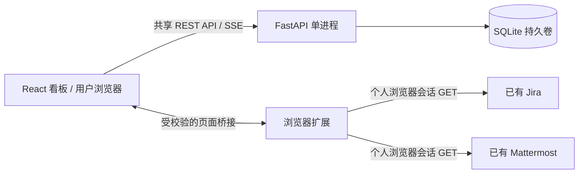

# 程序架构

## 数据流

看板服务器提供页面、共享 API 和 SSE，不代理 Jira / Mattermost。扩展只执行受限读取，浏览器必须能访问三个站点并信任证书；Docker 代理与 CA 不改变浏览器网络。

SQLite 保存列、卡片标题、笔记、关联标识、顺序、版本、归档和审计元数据。外部正文、头像和个人预览仅存在当前页面内存。手动填写的共享标题、笔记对其他使用者可见。

## 模块

| 路径 | 职责 |
| --- | --- |
| `app/` | FastAPI、校验、存储、迁移、归档、安全边界、生产 CLI |
| `src/web/` | React 看板、详情、归档、多语言 |
| `src/extension/` | 扩展后台、桥接、连接设置和权限 |
| `src/adapters/` | Jira / Mattermost 请求与解析 |
| `src/contracts/`、`src/generated/`、`contracts/` | 通信和 API 契约 |
| `dummy/`、`src/dummy/`、`src/probe/` | 模拟后端、控制界面、开发接入页 |
| `tools/`、`scripts/` | 开发服务、构建、打包和验证 |
| `docker/` | 兼容部署管理工具和健康检查 |

## 镜像和依赖

| 用途 | 定义 | 边界 |
| --- | --- | --- |
| 正式看板 | 根 `Dockerfile`，`production` | Python + runtime 依赖 + 生产包 + 健康检查；无 Node/fake/probe/测试/开发工具 |
| 扩展交付 | 同 Dockerfile，`extension` | 与镜像相同配置构建的扩展 |
| fake / 旧部署 | `docker/legacy.Dockerfile` | `app` 含模拟服务；保留 operations/source-tools/production 兼容目标 |
| 开发调试 | `.agent/Dockerfile` | Python + Node + 浏览器系统库，源码挂载 `/workspace`，独立依赖卷 |

正式构建采用 `Dockerfile.dockerignore` 白名单，排除 fake、probe、测试、本地配置与数据。旧镜像采用根 `.dockerignore`，开发上下文只含 Dockerfile 和 entrypoint。

`requirements/runtime.in` / `runtime.txt` 管理运行依赖及含哈希的锁；`dev.in` / `dev.txt` 仅用于开发。`package.json` / `package-lock.json` 用于前端构建，Node/npm 不进入正式运行阶段。Python 3.13.15 / Node 24.21.0 镜像固定 digest；升级时同步核对 `.agent/images.lock`、Dockerfile、版本文件及 package engines。

## 约束

同一份 production JSON 的三个公开地址编译进前端、扩展默认值和服务包；启动检查配置与构建一致。目前按环境构建镜像，不能只靠运行环境变量修改站点。配置不放凭据，地址会出现在交付产物中。

单实例、单 worker，SQLite 文件锁阻止第二进程共享数据库，不支持多副本。反向代理保留 Host、支持 SSE 并关闭缓冲。Host / Origin 校验不等于用户身份认证，正式环境须由公司入口限制访问；个人预览遵循源站权限。

fake 模拟身份、权限及故障，不会自动切换真实服务，不能证明真实 SSO 可用。
